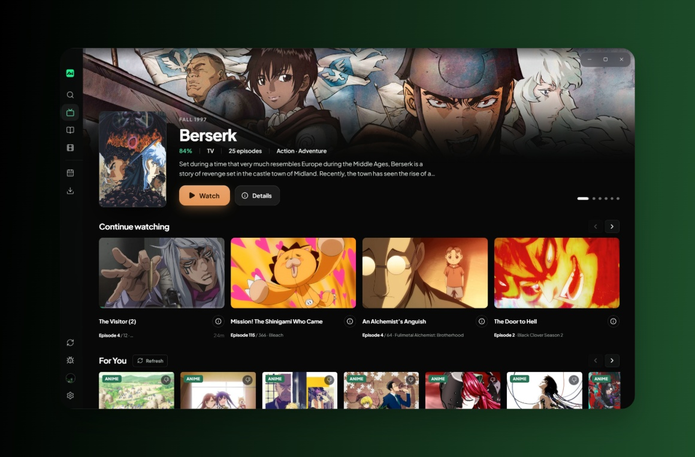
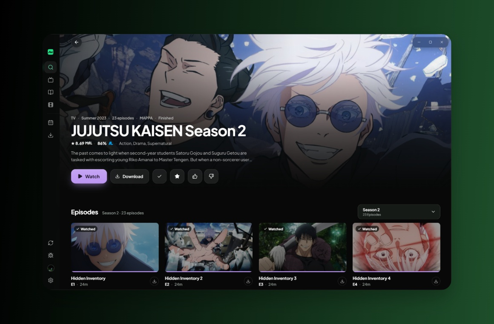
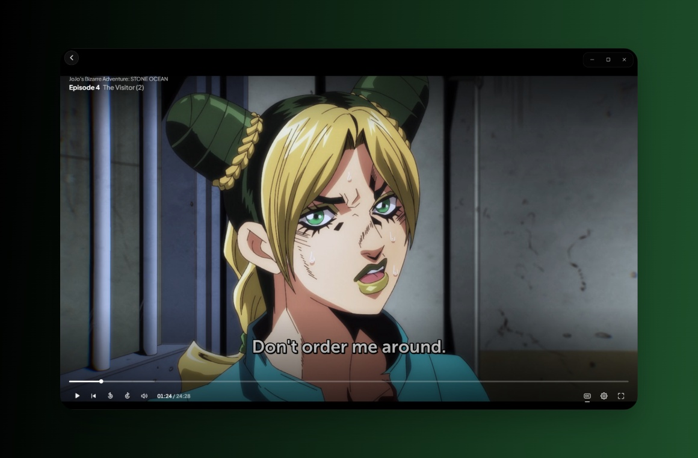
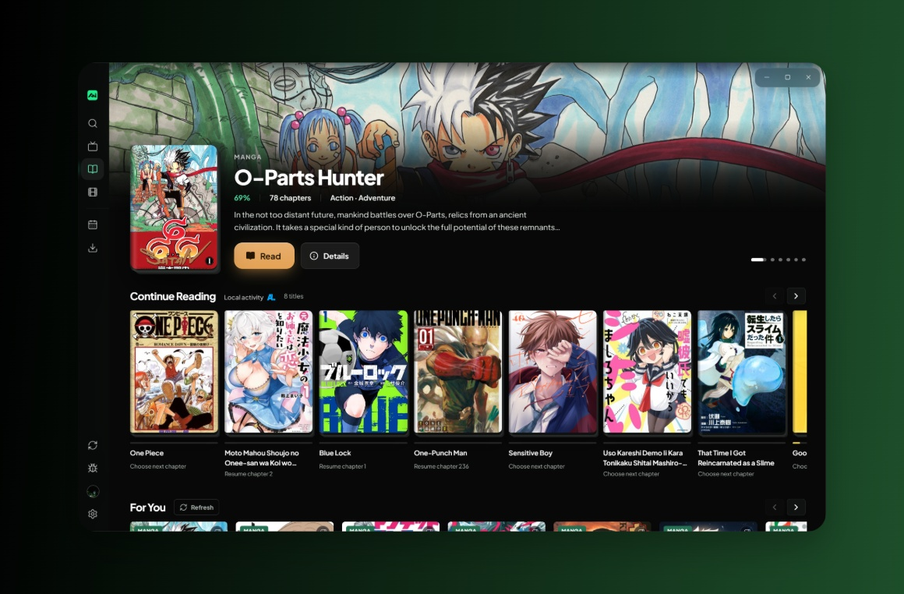
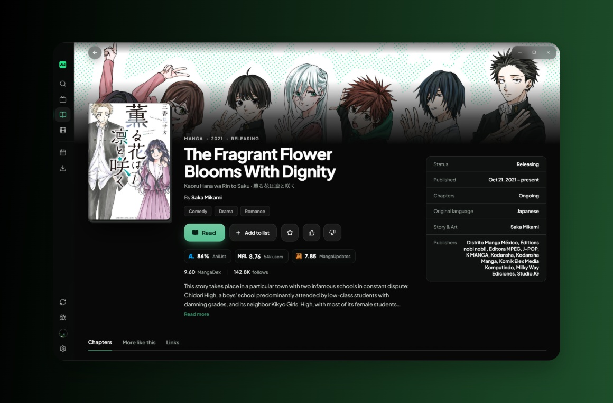

<p align="center">
  
</p>

<h1 align="center">AniStream</h1>

<p align="center">
  Anime, manga, movies and shows in one ad-free desktop app.
</p>

<p align="center">

</p>

<p align="center">
  <a href="https://github.com/Athen2045/AniStream/releases/latest">Download</a> |
  <a href=".github/releases/v2.2.2.md">Release notes</a> |
  <a href="CHANGELOG.md">Changelog</a> |
  <a href="LEGAL.md">Copyright</a>
</p>

<div align="center">
  <a href="https://github.com/Athen2045/AniStream/releases/latest">
    
  </a>
  <a href="https://github.com/Athen2045/AniStream/releases">
    
  </a>
  <a href="https://github.com/Athen2045/AniStream/actions/workflows/ci.yml">
    
  </a>
  
  
</div>

<h5 align="center">
Leave a star if you like the project! ⭐️
</h5>

## About

AniStream is a **desktop app** for anime, manga, movies and shows. Browse what's trending, watch
episodes, read chapters, and pick up exactly where you left off. Everything you do stays on your
computer, and you can connect AniList or Simkl to sync your lists if you want to.

> [!IMPORTANT]
> AniStream does not host, store, or distribute any videos or manga. Streaming and reading
> availability depends on outside providers and can change without notice. Only watch or read media
> you are legally allowed to access where you live.

## Why AniStream

- **No ads, ever.** No banners, no pop-ups, no trackers, not even inside the video players.
- **A player made for anime.** **Skip opening**, and skip the ending straight to the **next
  episode**. Sub or dub, your choice of audio and subtitles, previews when you seek, and keyboard
  shortcuts. If one player can't play an episode, a backup takes over by itself.
- **Watch offline.** Download one episode or a whole season and watch it without a connection,
  within a storage limit you set. Downloads wait out a lost connection, and can finish in the
  background after you close the window.
- **Read manga without the clutter.** A fullscreen reader that remembers your page, chapters
  grouped by volume, and quick shortcuts for chapters, fit and fullscreen. Download chapters at
  original quality to read offline, sharing the same storage limit as episodes.
- **Movies and shows too.** The More section brings trending films and series, season grids and
  your own watch list.
- **Recommendations that get you.** For You learns from what you watch and read, right on your
  device, and works without an account. Mark a title **Not interested** and it listens.
- **Never miss an episode.** An airing schedule, a "Ready for you" list of new episodes and
  chapters, and an **Up Next** queue you can save as playlists.
- **Find anything fast.** One search for Anime, Manga, or Movies & TV, with results as you type,
  filters, and "Did you mean" for typos.
- **Your lists, your choice.** Track progress locally, or sync with AniList (anime and manga) and
  Simkl (movies and shows). Edits made offline sync once you're back online.
- **Private by default.** No telemetry and nothing sold or shared. Back up your data whenever you
  like.
- **Stays up to date.** On Windows, new versions download in the background and install with one
  click.

### Watch

<table>
  <tr>
    <td width="50%"></td>
    <td width="50%"></td>
  </tr>
  <tr>
    <td align="center">Title pages with episodes, downloads and ratings</td>
    <td align="center">AniStream's own player</td>
  </tr>
</table>

### Read

<table>
  <tr>
    <td width="50%"></td>
    <td width="50%"></td>
  </tr>
  <tr>
    <td align="center">Manga home with Continue Reading</td>
    <td align="center">Manga title pages with scores from every source</td>
  </tr>
</table>

## Get started

Download the installer for your platform from the
[latest release](https://github.com/Athen2045/AniStream/releases/latest).

| Platform | File                        | Requires                           |
| -------- | --------------------------- | ---------------------------------- |
| Windows  | `AniStream.Setup.2.2.2.exe` | Windows 10 or 11, x64              |
| macOS    | `AniStream-2.2.2-arm64.dmg` | macOS 12 or newer on Apple Silicon |

Both installers are unsigned. On Windows, select **More info → Run anyway** if SmartScreen warns
you. On macOS, open **System Settings → Privacy & Security** and choose **Open Anyway** after the
first launch. Each release includes a `SHA256SUMS.txt` file to verify your download, and from
2.2.2 each installer is attested to the release workflow that built it:
`gh attestation verify AniStream.Setup.<version>.exe --repo Athen2045/AniStream`.

> [!TIP]
> Already have AniStream? Install the new version over your existing copy; your progress,
> settings and AniList session are kept. From 2.0.1 on, Windows updates itself: AniStream downloads
> new releases in the background and shows **Restart to update** when they're ready. Nothing
> installs until you choose it. On macOS, AniStream links you to the release to install yourself.

## Goal

I wanted one place to enjoy anime, manga and movies that feels good to use: no ads jumping in the
way, no hunting for where I left off, and recommendations that actually match what I like.
AniStream is my attempt at that, and honestly, it's a fun project to work on. Every update is a
chance to try a new idea, polish a small detail, or learn something new.

It is built around a few simple rules: no ads, your data stays on your device, nothing is sold or
shared, and every integration is optional.

## Tech stack

| Area      | Tools                                                                                                                                                                              |
| --------- | ---------------------------------------------------------------------------------------------------------------------------------------------------------------------------------- |
| Desktop   | [Electron](https://www.electronjs.org/), [electron-builder](https://www.electron.build/) and [electron-updater](https://www.electron.build/auto-update) for installers and updates |
| Interface | [React](https://react.dev/), [TypeScript](https://www.typescriptlang.org/), [Framer Motion](https://motion.dev/), [Lucide](https://lucide.dev/) icons                              |
| Data      | [TanStack Query](https://tanstack.com/query) for fetching and caching, [SQLite](https://www.sqlite.org/) via `better-sqlite3` for local storage                                    |
| Video     | [Video.js](https://videojs.org/), [hls.js](https://github.com/video-dev/hls.js) for streaming, [JASSUB](https://github.com/ThaUnknown/jassub) for styled subtitles                 |
| Build     | [electron-vite](https://electron-vite.org/) and [Vite](https://vite.dev/)                                                                                                          |
| Quality   | [Vitest](https://vitest.dev/), [Playwright](https://playwright.dev/), ESLint, Prettier, GitHub Actions                                                                             |
| Data from | [AniList](https://anilist.co/), [MangaDex](https://mangadex.org/), [TMDB](https://www.themoviedb.org/), [MyAnimeList](https://myanimelist.net/), [Simkl](https://simkl.com/)       |

## Development and Build

You'll need [Node.js](https://nodejs.org/en/download) 22 or newer.

```bash
git clone https://github.com/Athen2045/AniStream.git
cd AniStream
npm ci
cp .env.example .env
npm run dev
```

Discovery, lists, and reading work with the defaults in `.env.example`. Playback endpoints are not
part of this repository; copy `providers.example.json` to `providers.local.json` to configure them.

See [CONTRIBUTING.md](.github/CONTRIBUTING.md) for checks, packaging, and the release workflow. Bug
reports and ideas are welcome through the
[issue forms](https://github.com/Athen2045/AniStream/issues/new/choose); report security problems
privately as described in [SECURITY.md](.github/SECURITY.md).

<br>

> [!NOTE]
> AniStream is an independent personal project and is not affiliated with AniList, MangaDex,
> MyAnimeList, TMDB, Simkl, or any playback provider. For copyright-related requests, see
> [LEGAL.md](LEGAL.md).
